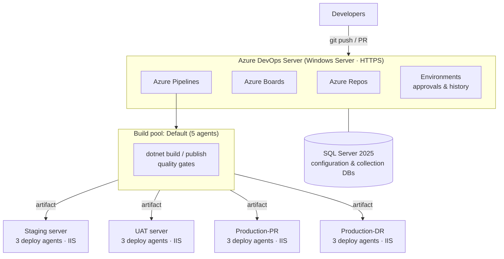
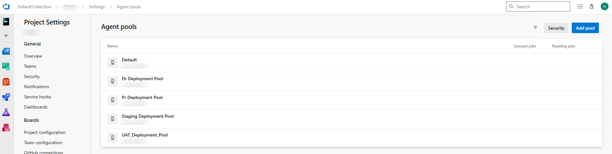
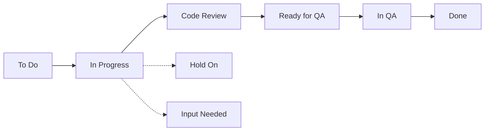
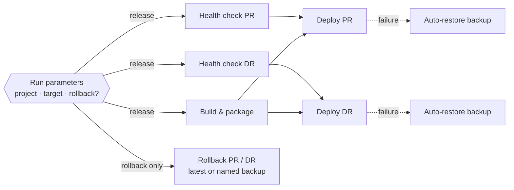

# 🚀 On-Premises Azure DevOps Server for a Payments Platform

> Designed and rolled out a self-hosted **Azure DevOps Server** for a fintech engineering team that previously had **no source-control workflow, no work tracking, and fully manual deployments**. The result: Git with enforced PR policies, sprint-based Boards, and multi-stage YAML pipelines that deploy .NET apps to IIS across **Staging, UAT, and Production (primary + DR)** with health checks, backups, and one-click rollback.

-0078D7?logo=azuredevops&logoColor=white)


> ℹ️ This is a **sanitized reference implementation** of a production setup. Company, project, server, and people names are replaced with placeholders (`PortalApp`, `<PROJECT>`, `Production-PR Pool`, …).

---

## 📑 Table of Contents

1. [Overview](#1-overview)
2. [Before & After](#2-before--after)
3. [Architecture](#3-architecture)
4. [Server Installation](#4-server-installation)
5. [Self-Hosted Agents](#5-self-hosted-agents)
6. [Azure Repos & Branch Policies](#6-azure-repos--branch-policies)
7. [Azure Boards](#7-azure-boards)
8. [Pipeline Design](#8-pipeline-design)
9. [Production Release Pipeline: Deep Dive](#9-production-release-pipeline-deep-dive)
10. [Quality & Security Gates](#10-quality--security-gates)
11. [Challenges & Solutions](#11-challenges--solutions)
12. [Using This Repository](#12-using-this-repository)
13. [Future Improvements](#13-future-improvements)

---

## 1. Overview

| Area | What was built |
|---|---|
| **Platform** | Single-server Azure DevOps Server on Windows Server, SQL Server 2025 configuration DB, HTTPS |
| **Agents** | 5 build agents + 3 deployment agents on each target server (Staging, UAT, Production-PR, Production-DR) |
| **Repos** | Git repositories per service with sandbox → production branch flow and PR policies |
| **Boards** | Two-week sprints, custom task workflow, capacity planning |
| **Pipelines** | Multi-stage YAML: health check → build → deploy → auto-rollback, plus on-demand rollback |
| **Quality gates** | Static analysis, dependency scanning, AI-assisted PR review |

## 2. Before & After

| | Before | After |
|---|---|---|
| Source control | No consistent Git workflow | Git repos per service, PR-only merges into protected branches |
| Work tracking | None | Sprints, backlog, task board, capacity |
| Deployments | Manual copy to IIS servers | One-click pipelines to Staging, UAT, PR, and DR |
| Release safety | No backups or checks | Server health check, automatic pre-deploy backup, auto-rollback |
| Rollback | Manual restore | Pipeline parameter: roll back to *latest* or a named backup |
| Typical release | ~30–45 minutes, manual (per server) | **~4–7 minutes** end to end |

## 3. Architecture



**Key decisions**

- **On-premises, single server.** The payments workload and its data stay inside the corporate network, which suits a PCI DSS–scoped environment. A single application + data tier keeps operations simple at this team size.
- **Agents live on the target servers.** Each deployment server runs its own agents in a dedicated pool, so deployments are local file operations (no WinRM/SMB copy across the network) and only outbound connections to the ADO server are needed.
- **Build once, deploy many.** One artifact is promoted to every environment, so what was tested in UAT is byte-for-byte what reaches production.

## 4. Server Installation

| Component | Choice |
|---|---|
| OS | Windows Server |
| Topology | Single server (application tier + data tier) |
| Database | SQL Server 2025 |
| Access | HTTPS with internal certificate, domain authentication |
| Collection | `DefaultCollection` with one project per product |

**Install outline**

1. Install SQL Server and confirm the service account and collation required by Azure DevOps Server.
2. Install Azure DevOps Server and run the **Server Configuration Wizard** (new deployment, basic).
3. Bind the site to **HTTPS** with the internal certificate and update the public URL.
4. Create the collection and project, then configure permissions with AD groups.
5. Configure scheduled backups from the **Administration Console**.

## 5. Self-Hosted Agents

| Pool | Purpose | Agents |
|---|---|---|
| `Default` | Build, test, package, quality gates | 5 |
| `Staging Deployment Pool` | Deploy to staging IIS | 3 |
| `UAT_Deployment_Pool` | Deploy to UAT IIS | 3 |
| `Production-PR Pool` | Deploy to primary production | 3 |
| `Production-DR Pool` | Deploy to disaster-recovery production | 3 |



- Agents run as **Windows services** under dedicated service accounts, with only the IIS and file-system rights they need.
- Build agents have the required **.NET SDKs**. Pipelines also pin versions with `UseDotNet@2`, so builds don't depend on whatever is installed.
- **Three agents per deployment server** let several services deploy to the same server in parallel without queueing.

## 6. Azure Repos & Branch Policies

**Branching flow**

```mermaid
gitGraph
    commit id: "master (production)"
    branch sandbox
    checkout sandbox
    commit id: "integration"
    branch feature/xyz
    checkout feature/xyz
    commit id: "work"
    commit id: "fix"
    checkout sandbox
    merge feature/xyz id: "PR → sandbox"
    checkout master
    merge sandbox id: "PR → master"
```

- `feature/*` → **PR** → `<Repo>_Sandbox`, which is deployed to the sandbox/UAT environment
- `<Repo>_Sandbox` → **PR** → `master`, which is released to production

**Policies on protected branches**

- Direct pushes blocked; changes land only through pull requests
- Required reviewer approval
- Linked work item required, so every change traces back to a Board item
- All comments must be resolved before completing
- Automated AI code review runs on each PR (see [Section 10](#10-quality--security-gates))

## 7. Azure Boards

- **Two-week sprints** with capacity planning (hours per person per day) and a burndown chart.
- **Backlog hierarchy:** Feature / PBI → Tasks, with tasks grouped under their parent item on the taskboard.
- **Custom task workflow** that mirrors how work actually moves through the team:



`Hold On` and `Input Needed` make blocked work visible in stand-ups instead of sitting silently as "In Progress".

## 8. Pipeline Design

**Central pipelines repository.** All YAML lives in one DevOps repo. Each pipeline checks out the application repo as a secondary resource:

```yaml
resources:
  repositories:
    - repository: AppRepo
      type: git
      name: <PROJECT>/<APP_REPO>
      ref: refs/heads/master
```

This keeps deployment logic reviewable in one place, stops developers from changing production deployment steps through an application PR, and lets one change roll out to every service.

**Pipeline catalogue** (one per service and environment):

| Pipeline | Trigger | Target |
|---|---|---|
| `<Service>` CI | PR / branch push | Build + validation |
| `<Service>` Sandbox / UAT | Manual | Staging & UAT pools |
| `<Service>` Production | Manual + environment approval | PR, DR, or both |
| IIS site provisioning | Manual (parameterised) | New site + app pool + bindings + certificate |
| Documentation | Manual | Internal docs site |

## 9. Production Release Pipeline: Deep Dive

📄 [`pipelines/production-iis-release.yml`](pipelines/production-iis-release.yml) · templates in [`pipelines/templates/`](pipelines/templates/)



### 9.1 Run-time parameters

| Parameter | Values | Purpose |
|---|---|---|
| `selectedProject` | `PortalApp.Web`, `PortalApp.CronJob` | One pipeline serves several projects in the same repo; paths, app pools, and backup folders are mapped per project |
| `deployTarget` | `PR`, `DR`, `Both` | Release to primary, DR, or both from **one build** |
| `performRollback` | `true` / `false` | Skip everything and only restore a backup |
| `backupToRestore` | `latest` or a file name | Choose exactly which version to go back to |

Stages are included or excluded with **compile-time** `${{ if }}` expressions, so a PR-only release doesn't even show DR stages in the run view.

### 9.2 Stage 0: Dry-run health check

Runs **on the target server, in parallel with the build**, and aborts the release before anything is touched if:

- free disk space on the app drive or backup drive is **below 5%**,
- average CPU (3 samples) is **above 90%**,
- memory use is **above 90%**, or
- the IIS app pool can't be read (which catches agent permission problems early).

### 9.3 Stage 1: Build & package

- `dotnet publish` with a pinned SDK.
- **`appsettings*.json` and `web.config` are stripped from the artifact.** Environment configuration (connection strings, keys) stays on each server and is never overwritten by a release or stored in the artifact.
- The output is zipped and published as a single artifact, which is reused for every target.

### 9.4 Stage 2: Deploy with automatic rollback

```
Stop app pool ──► wait until really Stopped (≤90 s)
       │
       ▼
Zip current release → PreDeploy_Backup_<timestamp>.zip  (keep newest 5)
       │
       ▼
Extract artifact → robocopy into site folder
       │
       ├── success ──► Start app pool ✅
       │
       └── failure ──► files touched? ── yes ─► wipe folder, restore backup, start app pool, fail run
                                       └─ no ──► start app pool, fail run (nothing changed)
```

Details that matter in production:

- **Polls the app pool state.** `Stop-WebAppPool` returns before the worker process exits, and copying too early hits locked DLLs.
- **Backup is taken after the stop**, so the zip never contains half-written or locked files.
- **Tracks whether files were touched.** If the failure happens before the copy, there's nothing to restore, and restoring anyway could downgrade production.
- **Handles robocopy exit codes correctly.** Codes 0–7 mean success, ≥ 8 means failure, and the script exits 0 explicitly so a successful copy doesn't fail the task.
- **Deployment jobs bound to Environments** (`Production-PR`, `Production-DR`) give approval gates and a deployment history per environment.

### 9.5 On-demand rollback

Run the pipeline with `performRollback = true`, pick the target, and choose `latest` or a specific `PreDeploy_Backup_*.zip`. The rollback stage stops the app pool, clears the folder, restores the backup, and starts the pool. It doesn't depend on a build, so recovery takes **seconds to a few minutes**.

## 10. Quality & Security Gates

| Gate | Tool | What it catches |
|---|---|---|
| Static analysis | SonarQube | Bugs, code smells, security hotspots, duplication |
| Dependency scanning | Snyk | Vulnerable NuGet / npm packages |
| AI PR review | Claude Code via a pipeline review task | Logic errors, missing validation, risky changes; guided by repo-level `CLAUDE.md` and `code-review.md` rules files |
| Branch policies | Azure Repos | No unreviewed code reaches protected branches |

## 11. Challenges & Solutions

| Challenge | Solution |
|---|---|
| **Starting from zero.** No Git workflow, no tracking, manual releases | Rolled out in phases: Repos and branch policies first, then Boards, then CI, then CD per environment, with production last |
| **AI PR review failed silently on large PRs** | Traced to the review task hitting its budget limit on big diffs and exiting without an error. Raised the limit for large PRs, excluded generated files from the diff, and made the task log an error when a review is cut off, so a skipped review is never mistaken for a clean one |
| **PAT permission gaps** for the review task | The token could read code but not post PR comments, so reviews ran without visible output. Issued a dedicated service-account PAT with Code (Read & Write) scope for PR threads, stored as a secret pipeline variable |
| **PR and DR servers differ** in paths, app pools, and backup locations | Per-site variable mapping + reusable stage templates; one build, deploy to either or both |
| **Locked files during deploy** | Stop the app pool and poll until it's really stopped before backing up or copying |
| **Releases overwriting server config** | Strip `appsettings*.json` / `web.config` from the artifact at build time |
| **Safe recovery** | Automatic backup + retention on every deploy, auto-restore on failure, manual rollback to any kept backup |

## 12. Using This Repository

```
AzureDevOps-Server-OnPrem/
├── README.md
├── pipelines/
│   ├── production-iis-release.yml        # main multi-stage pipeline
│   └── templates/
│       ├── health-check-stage.yml        # disk / CPU / memory / app-pool dry run
│       ├── deploy-iis-stage.yml          # stop → backup → sync → start, auto-rollback
│       └── rollback-iis-stage.yml        # restore latest or named backup
└── docs/screenshots/
```

To adapt it:

1. Create agent pools `Default`, `Production-PR Pool`, `Production-DR Pool` and register agents on the servers.
2. Create Environments `Production-PR` and `Production-DR` and add approvals.
3. Replace `<PROJECT>/<APP_REPO>`, `<PROD_VARIABLE_GROUP>`, project paths, and IIS paths in `production-iis-release.yml`.
4. Create a pipeline from the YAML in your pipelines repo.

## 13. Future Improvements

- Health-check the **application** after deploy (HTTP 200 on a `/health` endpoint) and roll back automatically if it fails.
- Move per-project mappings into **variable templates** so adding a service is a one-file change.
- Blue/green deployment on IIS (two site folders and a binding switch) for zero-downtime releases.
- Infrastructure-as-code for agent and IIS server setup (DSC / Ansible).
- Scale out to separate application and data tiers as the team grows.

---

**Author:** Hussain Malik
